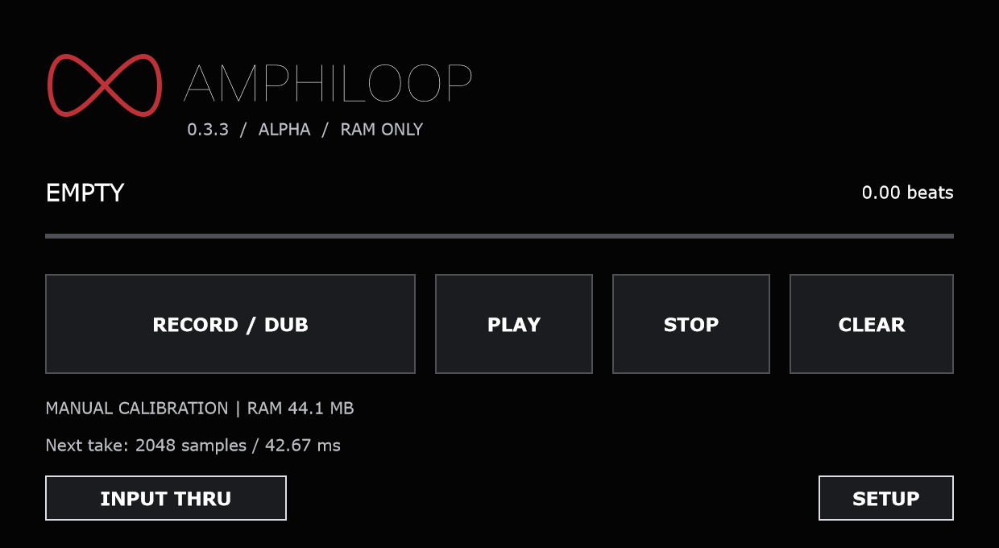

# AmphiLoop

A mono/stereo looper for Windows VST3 hosts. Record, overdub and undo loops up to 60 seconds long.

**[Download for Windows — 0.3.3 alpha](https://github.com/JesseManser/AmphiLoop/releases/download/v0.3.3-alpha/AmphiLoop-0.3.3-alpha-Windows-x64.zip)**



## Install

Extract the ZIP, close your music software, and copy the entire **AmphiLoop.vst3** folder into `C:\Program Files\Common Files\VST3`. Reopen your host, rescan plugins if needed, and load **AmphiLoop by amphiox** as an audio effect. Requires Windows 64-bit and a VST3 host. For missing runtime DLLs, install the [Visual C++ x64 Redistributable](https://aka.ms/vc14/vc_redist.x64.exe).

## Use

- **Record / Dub:** record an empty loop; press again to play. Tap during playback to overdub. Double-press to stop. Hold for two seconds during playback to undo/redo the last overdub, or while stopped to clear.
- **Play / Stop / Clear:** start playback, stop while keeping the loop, or erase it.
- **Input Thru:** hear live input alongside the loop; off by default.

With host transport running, Record/Play/Stop take effect at the next bar. Map buttons through your host using momentary press/release values; direct MIDI input is not supported.

**Calibration:** in Setup, start Recording correction at zero. Record a repeating click through your normal audio path. Increase correction if playback is late; decrease it if early. Clear and rerecord after each adjustment, then check overdubs. Changes apply to new recordings, not existing audio. Recheck after changing buffers, sample rate, routing or effects.

**Alpha limits:** loop audio stays in memory and is **not saved with your project**. Record the output before closing the plugin to keep it. Tempo changes alter pitch; overdubbing requires the original recording tempo.

## Build

Requires Visual Studio 2022 C++ and CMake 3.22+. JUCE 8.0.9 is fetched automatically.

```powershell
cmake -S . -B build -G "Visual Studio 17 2022" -A x64
cmake --build build --config Release --parallel 4
ctest --test-dir build -C Release --output-on-failure
```

By Jesse Manser / AMPHIOX. [AGPL-3.0-only](LICENSE) · [Third-party notices](THIRD_PARTY_NOTICES.md).

